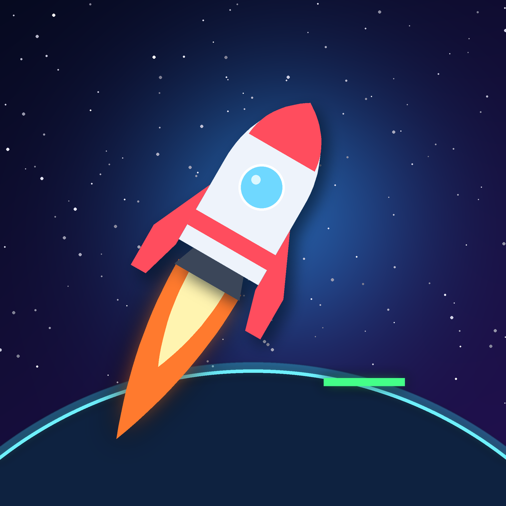

# Thrustbound 🚀

*Defy gravity. Stick the landing.*

Thrustbound is a portrait iPhone game where you pilot a small rocket through 40 levels. Gravity always pulls you down. You steer with a stick, fire the engine with a **GAS** button, and have to touch down gently on the green landing pad without crashing or running out of fuel.

<p align="center"></p>

## How to play

| Control | What it does |
| --- | --- |
| **Stick** (bottom left) | Point the rocket's nose in any direction. If you touch anywhere on the left half of the screen, the stick moves under your thumb. |
| **GAS** (bottom right) | Fires the engine and pushes the rocket the way its nose points. The whole right half of the screen works as the button. |

- **Land** on the green pad slowly (the speed meter must not be in the red) and upright, then hold still for a moment.
- **Fuel** is limited. Only thrust burns fuel; rotating is free. Orange cans refill the tank.
- **Stars**: every level has 3. Collect them and land to keep them (120 in total).
- **Red means danger**: spikes, mines, spinning blades and lasers destroy the rocket. Hitting rock too fast does too, but gentle scrapes are fine.
- **Wind** zones (blue streams) push you around. **Keys** open the door of the same colour.

## Worlds

1. **Launch Bay**: learn to hover, steer and land.
2. **Crystal Caverns**: jagged caves, spikes, updrafts, downdrafts and crosswinds.
3. **Reactor Core**: timed lasers, spinners, patrolling mines, keys and doors.
4. **Deep Void**: long levels that combine everything, ending with a 3,300-point climb.

The game is available in **English and Russian**. It follows the iPhone's language automatically (Russian when the system language is Russian, English otherwise), and *Settings → Language* lets you force either one.

Levels unlock one after another. You can turn on *Settings → Unlock all levels* if you want to jump around. There is also a left-handed option that swaps the stick and the GAS button.

## Install on your iPhone (sideload)

Every push builds the app on GitHub Actions. Tagged versions are published as an **unsigned `.ipa`** on the [Releases](../../releases) page.

1. Download `Thrustbound-vX.Y.Z.ipa` from the latest release.
2. Install it with a sideloading tool, which signs it with your own Apple ID:
   - **Sideloadly** (Windows or macOS): plug in your iPhone, drag the IPA in, enter your Apple ID, press *Start*.
   - **AltStore / SideStore**: open the IPA with AltStore (*My Apps → +*).
   - **TrollStore** (on supported iOS versions): open the IPA with TrollStore.
3. On iOS 16 or later, enable **Settings → Privacy & Security → Developer Mode** when iOS asks for it.

With a free Apple ID, sideloaded apps must be refreshed every 7 days. AltStore and SideStore can refresh automatically. You need iOS 15 or later.

## Building

The Xcode project is generated from [`project.yml`](project.yml) with [XcodeGen](https://github.com/yonaskolb/XcodeGen):

```sh
brew install xcodegen
xcodegen generate
open Thrustbound.xcodeproj
```

CI (`.github/workflows/ios.yml`) does the following on every push:

1. generates the project,
2. runs the unit tests on an iOS simulator (physics, landing, hazards, keys and doors, and a check that the rocket can rest safely on every launch pad),
3. builds a Release `.ipa` without code signing and uploads it as a workflow artifact,
4. for a `v*` tag, or a manual run with a `release_tag`, publishes the IPA to GitHub Releases.

To cut a release: **Actions → iOS Build → Run workflow**, then enter a tag such as `v1.0.1`. Pushing a tag such as `git tag v1.0.1 && git push origin v1.0.1` does the same.

## Project layout

```
Thrustbound/
  App/            SwiftUI app entry, navigation, saved progress (AppModel) and translations (Localization.swift)
  Game/           Simulation (GameWorld), SpriteKit rendering (GameScene), controls, art
  UI/             Menus, level select, HUD and overlays, settings, how-to
  Services/       Sound effects and haptics
  Resources/      levels.json and sound effects
  Assets.xcassets App icon and colours
ThrustboundTests/ Unit tests
tools/            Level editor DSL, validator, icon and sound generators (Python)
```

### Level design tools

The levels are written in Python in [`tools/levels.py`](tools/levels.py) using a small DSL (rooms, tunnels, rocks, pads, hazards). The build script turns them into `Thrustbound/Resources/levels.json` and checks every level. It verifies that the pads sit on solid ground, and runs a flood fill sized to the rocket to confirm that the goal, every star, fuel can and key can be reached, with doors only opening once their key is collected. Finally, an autopilot ([`tools/autopilot.py`](tools/autopilot.py)) flies every level using a Python copy of the game's physics. It collects all three stars and lands, and each tank is sized so the autopilot needs at most about 60% of it.

```sh
pip install numpy scipy shapely pillow
python3 tools/build_levels.py --render previews   # rebuild + validate + PNG previews
python3 tools/make_assets.py                      # regenerate app icon + sounds
```

The app icon and all sound effects are generated procedurally by `tools/make_assets.py`.
